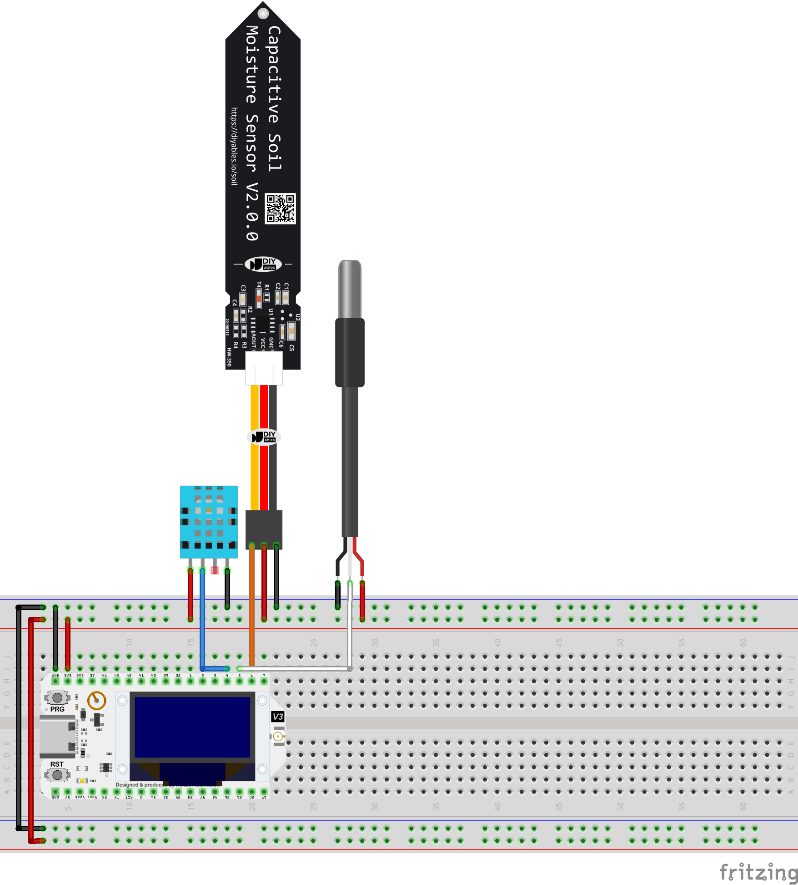
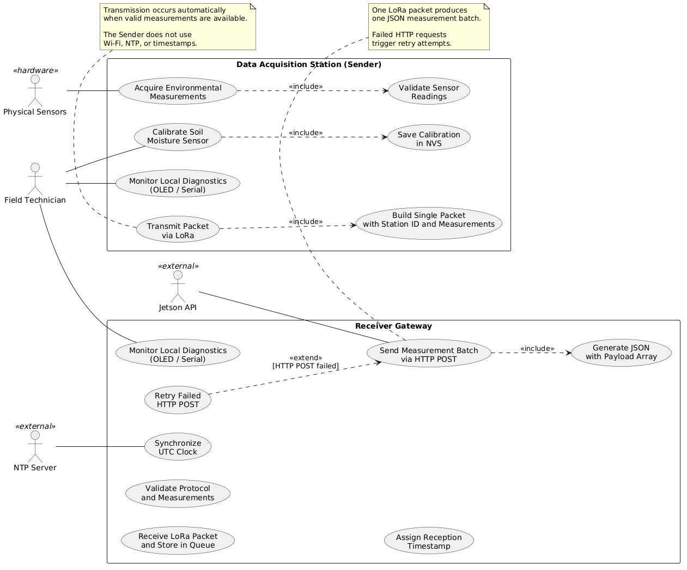
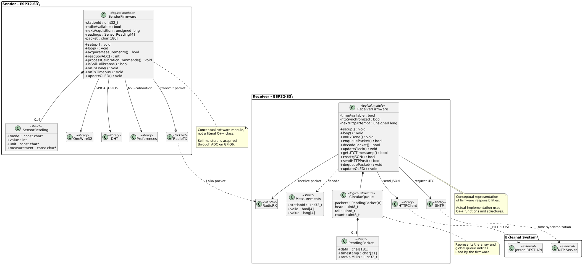
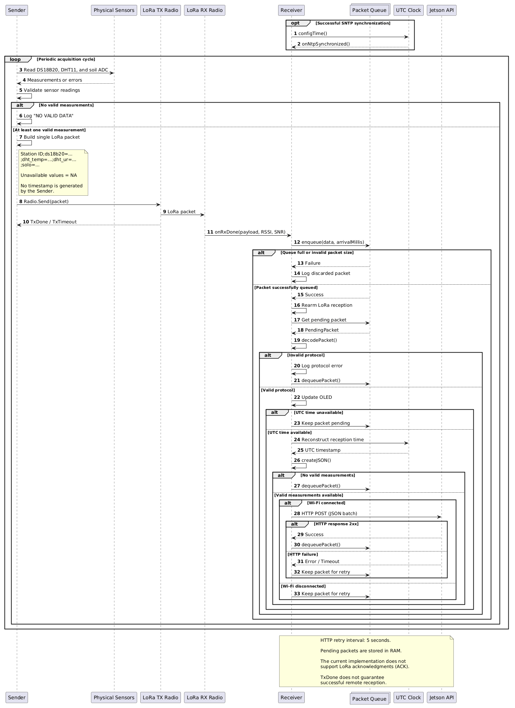
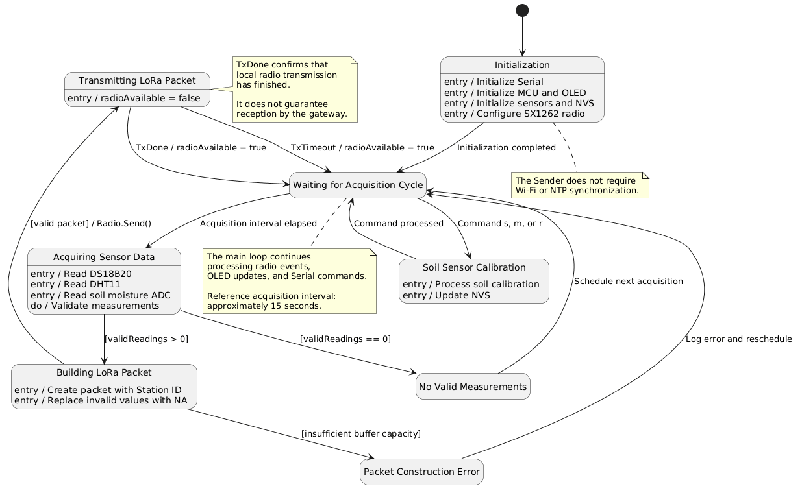
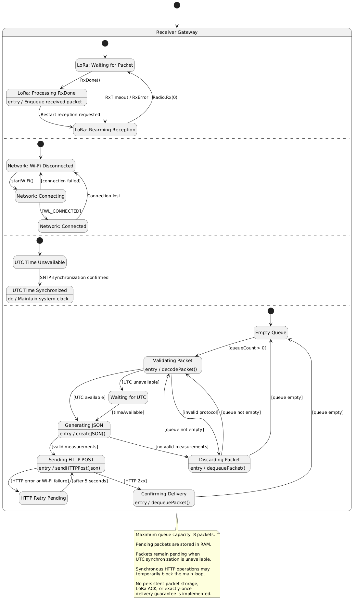

<div align="center">


# SAERPA — Embedded Environmental Monitoring System

**Universidade do Vale do Itajaí (UNIVALI)**  
**Team Deadalus**  
**NASA Space Apps Challenge 2026**  
**Challenge:** [Field Shift: Adapting Farms with NASA Data](https://www.spaceappschallenge.org/2026/challenges/field-shift-adapting-farms-with-nasa-data/)  
**Foundational concept:** [Sisteminha Embrapa](https://www.embrapa.br/en/web/meio-norte/sisteminha)

*Environmental data acquisition, LoRa telemetry, and local gateway integration for small-scale farming.*

</div>

## Overview

**SAERPA** is a climate-adaptive farming decision-support project designed around the needs of small-scale and family farmers. At the system level, it aims to bring together NASA Earth observation data (including SMAP and POWER), local environmental measurements, crop history, and agronomic knowledge to support informed planting and crop-rotation decisions.

This repository documents **SAERPA's embedded data acquisition and transmission subsystem**. It does not implement agronomic recommendations. Instead, it provides an on-farm measurement pipeline: a sensor station gathers environmental data, transmits one aggregated LoRa packet, and a receiver gateway timestamps and forwards the measurements to the Jetson-hosted backend.

The approach is inspired by the **Sisteminha Embrapa** principles of small-scale, modular, accessible, and resource-conscious food production. This project is an independent academic/hackathon effort; no official endorsement or partnership with Embrapa or NASA is implied.

## Scope

**Included in this subsystem**

- Physical acquisition of temperature, relative air humidity, and calibrated soil moisture.
- Per-sensor reading validation and persistent dry/wet calibration for the soil probe.
- Aggregation of sensor values into **one LoRa packet per valid acquisition cycle**.
- LoRa communication between two Heltec ESP32-S3/SX1262 boards.
- Gateway-side protocol validation, reception timestamping in UTC, JSON conversion, and HTTP forwarding.
- Local diagnostics using OLED displays and Serial output.

**Outside this subsystem**

- NASA POWER/SMAP ingestion and satellite-data synchronization.
- Crop registration, rotation strategies, agronomic recommendations, and the farmer-facing interface.
- Database implementation and server-side business logic on the Jetson.
- Autonomous irrigation control, actuation, and automated agricultural decisions.

The **current MVP** targets vegetables and herbs. A multi-station network serving other Sisteminha modules is a future architectural direction, not a demonstrated feature of the present firmware.

## Objectives

### General objective

Design and implement a modular embedded telemetry subsystem that acquires local environmental measurements and reliably structures them for integration into SAERPA's on-premises decision-support platform, minimizing reliance on internet connectivity at the sensor station.

### Specific objectives

1. Acquire soil-adjacent temperature (DS18B20), air temperature and relative humidity (DHT11), and soil moisture (capacitive probe).
2. Validate each reading independently and persist soil-probe calibration without replacing missing readings with fabricated values.
3. Associate measurements with a station ID and transmit one aggregated packet through LoRa.
4. Receive, validate, and temporarily queue LoRa packets at a local gateway.
5. Assign a UTC **reception timestamp at the gateway** using a synchronized clock; never generate timestamps at the sender.
6. Convert each valid packet into one JSON measurement batch and forward it to the Jetson API over Wi-Fi/HTTP.
7. Expose operating status and communication errors for on-site troubleshooting and support future modular expansion.

## Reference architecture

```text
 Physical sensors                    Heltec WiFi LoRa 32 V3 / V3.2
 DS18B20 / DHT11 / Soil ADC          SENDER (ESP32-S3 + SX1262)
            |                        - periodic acquisition
            +----------------------> - sensor validation / calibration
                                     - station ID + aggregated packet
                                                |
                                                | LoRa (915 MHz)
                                                v
                                     RECEIVER (ESP32-S3 + SX1262)
                                     - receive / validate / queue
                                     - UTC reception timestamp (SNTP)
                                     - JSON measurement batch
                                                |
                                                | Wi-Fi / HTTP POST
                                                v
                                     JETSON / SAERPA BACKEND
                                     - REST API / persistence
                                     - downstream decision-support
```

| Component | Responsibility | Internet required? |
| --- | --- | --- |
| **Sender / sensing node** | Acquire, validate, calibrate, and send measurements | **No** |
| **LoRa link** | Transport an aggregated packet to the gateway | **No** |
| **Receiver / gateway** | Parse, queue, timestamp, serialize, and POST measurements | Needs network access to the Jetson and an accessible trusted clock source |
| **Jetson backend** | Accept and persist records for SAERPA | Outside the scope of this repository |

> **Timing semantics:** the JSON timestamp identifies the **packet's reception at the gateway**, not the precise instant when an individual sensor conversion occurred. If time synchronization is delayed, the gateway estimates the reception time using the saved arrival `millis()` value after UTC becomes available.

## Hardware and interfaces

| Item | Platform / interface | Role |
| --- | --- | --- |
| Sender MCU + radio | Heltec WiFi LoRa 32 V3/V3.2, ESP32-S3 + SX1262 | Sensing and LoRa transmission |
| Receiver MCU + radio | Heltec WiFi LoRa 32 V3/V3.2, ESP32-S3 + SX1262 | LoRa-to-HTTP gateway |
| DS18B20 | GPIO4, 1-Wire, 4.7 kΩ pull-up to 3.3 V when required | Temperature |
| DHT11 | GPIO5, digital interface, pull-up as required by module | Air temperature and relative humidity |
| Capacitive soil probe (V2.0) | GPIO6, ADC | Calibrated soil-moisture percentage |
| Onboard OLED | SSD1306 via SDA GPIO17 / SCL GPIO18 (Vext GPIO36, reset GPIO21) | Local diagnostics |
| Local backend | Jetson-hosted HTTP API | Measurement ingestion |

Sensor power and GPIO signals must remain within ESP32-S3 electrical limits (3.3 V logic). The project uses a calibrated **relative soil-moisture percentage**, not a direct measurement of volumetric water content.

### Hardware prototype — wiring diagram

The following Fritzing diagram illustrates the **physical sensor-station prototype** using a Heltec ESP32-S3 board, a DS18B20 temperature probe, a DHT11 temperature/humidity sensor, and a capacitive soil-moisture sensor. It documents the intended wiring arrangement for the acquisition node (Sender), not the separate Receiver/Jetson gateway.

<p align="center">
  
</p>

<p align="center"><em>Figure 1 — Sensor-station prototype wiring (Fritzing).</em></p>

> **Hardware validation:** This is a prototype wiring illustration. Before powering the circuit, verify the module-specific pinout, common ground, supply voltage, pull-up resistors, and signal-to-GPIO mapping against the hardware-interface table above.

### LoRa reference settings

| Parameter | Configuration |
| --- | --- |
| Carrier frequency | 915 MHz |
| Bandwidth | 125 kHz |
| Spreading factor | SF7 |
| Coding rate | 4/5 |
| Preamble | 8 symbols |
| CRC | Enabled |
| IQ inversion | Disabled |
| Configured TX power | 5 dBm |

Both devices must use compatible radio settings. Deployment must comply with applicable local spectrum regulations.

## Business rules

The following business rules define the **intended SAERPA embedded subsystem behavior**. Identifiers (`RN-xx`) are retained from the original project specification for traceability. They are project-defined policies informed by the Sisteminha concept and the NASA Space Apps challenge—not official Embrapa requirements.

### Agricultural context and data provenance

| ID | Rule |
| --- | --- |
| RN-01 | Prioritize environmental variables relevant to monitoring small agricultural production areas. |
| RN-02 | Local sensor data complements, rather than automatically replaces, satellite-derived environmental information. |
| RN-03 | Every station must be identifiable so its readings can be associated with a production area by the central system. |
| RN-04 | Physical sensor measurements must remain distinguishable from satellite-derived, estimated, and simulated data. |
| RN-05 | The embedded subsystem supplies measurements; it does not autonomously recommend crops or control irrigation. |

### Acquisition and data integrity

| ID | Rule |
| --- | --- |
| RN-06 | A sampling cycle produces one logical measurement set for one station. |
| RN-07 | Invalid, unavailable, or uncalibrated measurements must not be replaced with fabricated real-world values. |
| RN-08 | Failure of one sensor must not invalidate valid measurements from other sensors. |
| RN-09 | Soil-moisture percentages require a valid dry/wet calibration. |
| RN-10 | Each measurement must retain an unambiguous variable, sensor model, and measurement unit. |
| RN-11 | A cycle containing no valid measurements must not generate an environmental observation record. |

### Communications and temporal traceability

| ID | Rule |
| --- | --- |
| RN-12 | The Sender must acquire and transmit without depending on internet access. |
| RN-13 | The Receiver, not the Sender, owns UTC timestamp assignment. |
| RN-14 | A batch timestamp represents gateway reception time, not exact sensor acquisition time. |
| RN-15 | One valid LoRa packet corresponds to one logical HTTP measurement batch; failed HTTP attempts may be retried. |
| RN-16 | A Jetson outage must not immediately stop LoRa reception, subject to the gateway's finite buffer capacity. |
| RN-17 | The gateway must not invent timestamps when it lacks a trustworthy clock reference. |
| RN-18 | Local radio transmit completion is not evidence of remote receipt or backend persistence. |

### Extensibility and future policies

| ID | Rule |
| --- | --- |
| RN-19 | Future stations should be identifiable by production module without ambiguity. |
| RN-20 | Adding sensor types should preserve backward compatibility or explicitly version the packet protocol. |
| RN-21 | Deployment should favor accessible parts, straightforward maintenance, and local infrastructure. |
| RN-22 | Future batches should have identifiers sufficient for duplicate detection and traceability. |

## Software requirements — implementation baseline

| Area | Implemented baseline | Current limitation / planned improvement |
| --- | --- | --- |
| **Acquisition** | DS18B20, DHT11, ADC soil probe; independent validation | Real-sensor integration still requires hardware validation |
| **Calibration** | Dry/wet commands saved in ESP32 NVS | Calibration must be repeated for a new probe or changed conditions |
| **Encoding** | Station ID, four ordered fields, `NA` for missing readings | Fixed protocol; no explicit version number |
| **LoRa** | Single aggregated SX1262 packet per valid cycle | No ACK, sequence number, or guaranteed delivery |
| **Gateway** | Packet parsing, OLED/Serial diagnostics, bounded RAM queue | Eight packets maximum; power loss clears the queue |
| **Clock** | UTC via SNTP; recovery of saved reception time after synchronization | NTP was not reachable on the tested guest Wi-Fi network |
| **HTTP** | One JSON POST per accepted packet; retries after failure | No verified end-to-end delivery guarantee or idempotency key |
| **Security** | Local Wi-Fi/HTTP integration in the prototype | Authentication and secure transport are future deployment requirements |

Implementation does not imply that every requirement has passed full physical or end-to-end acceptance testing.

## Communication and data contracts

### Sender → Receiver: LoRa payload

```text
1001;ds18b20=25;dht_temp=27;dht_ur=60;solo=41
```

- `1001`: station identifier (example).
- `ds18b20`: temperature in °C.
- `dht_temp`: air temperature in °C.
- `dht_ur`: relative air humidity in %.
- `solo`: calibrated soil-moisture percentage.
- Missing measurements are represented by `NA`, for example `solo=NA`.
- The Sender **does not** add a timestamp, connect to Wi-Fi, or generate JSON.

### Receiver → Jetson: one JSON batch per accepted packet

```json
{
  "id_estacao": 1001,
  "timestamp": "2026-11-15T18:30:00Z",
  "payload": [
    {
      "valor": 25,
      "modelo_sensor": "ds18b20",
      "unidade_de_medida": "C",
      "medida": "Temperatura"
    },
    {
      "valor": 27,
      "modelo_sensor": "dht11",
      "unidade_de_medida": "C",
      "medida": "Temperatura"
    },
    {
      "valor": 60,
      "modelo_sensor": "dht11",
      "unidade_de_medida": "%",
      "medida": "Umidade"
    },
    {
      "valor": 41,
      "modelo_sensor": "solo_cap_v2",
      "unidade_de_medida": "%",
      "medida": "UmidadeSolo"
    }
  ]
}
```

> Example values and timestamp are illustrative. The field names above reflect the current Jetson integration contract. Measurements encoded as `NA` are omitted from `payload`; an all-invalid batch is discarded.

## UML diagrams

The following UML models document the embedded subsystem's responsibilities and execution flow. The **class diagram uses conceptual modules** alongside real C++ structures; it is not a claim that every depicted class exists as a concrete class in the Arduino firmware. State-machine regions express logical concurrency, not separate runtime threads.

### 1. Use case diagram



External entities, available functions, calibration, diagnostics, and Jetson integration.

### 2. Class diagram



Logical modules, C++ data structures, libraries, interfaces, and relationships.

### 3. Sequence diagram



Acquisition, validation, LoRa transmission, reception, timestamp assignment, JSON serialization, and HTTP retries.

### 4. Sender state machine



Initialization, sensor acquisition, calibration, packet creation, transmission, and error handling.

### 5. Receiver state machine



LoRa reception, Wi-Fi connectivity, clock synchronization, packet queueing, and HTTP delivery.

## Setup and verification

**Firmware baseline:** physical-sensor Sender and gateway Receiver. A separate synthetic CSV demonstration exists for development, but it is **not** the baseline described here.

1. Install the **ESP32 board support package** and the **Heltec ESP32 Dev-Boards** library in the Arduino IDE; select **Heltec WiFi LoRa 32 (V3)**. The prototype used Arduino-ESP32 **3.0.2** and Heltec ESP32 Dev-Boards **2.1.6**.
2. Install the required sensor libraries: `esp32-ds18b20` (providing `OneWireESP32.h`), Adafruit DHT Sensor Library, and Adafruit Unified Sensor.
3. Connect the physical sensors to the Sender using the GPIO and power assignments above. Verify 3.3 V supply, common ground, and the required data-line pull-ups.
4. Configure the station identifier, radio parameters, and sensor wiring in the Sender firmware. Upload it and verify that the Serial monitor identifies the **single-packet, no-Wi-Fi/NTP** version.
5. Calibrate the soil probe using Serial at **115200 baud**: `s` captures the dry reference, `m` the wet reference, and `r` resets calibration. Confirm that calibration is valid before interpreting the soil percentage.
6. Configure the Receiver's Wi-Fi settings and replace the example `JETSON_URL` with the **actual reachable Jetson API address**. Ensure the Jetson service accepts the documented JSON schema.
7. Upload the Receiver firmware; confirm LoRa reception, accepted packet decoding, UTC synchronization, and HTTP response codes in Serial/OLED diagnostics.

**Important:** the original firmware includes a **placeholder** HTTP endpoint; it is not guaranteed to match the Jetson's deployed address. A Wi-Fi association alone does not establish NTP availability or Jetson reachability.

## Current validation status and limitations

- **Verified in serial logs:** basic LoRa reception, signal metrics (RSSI/SNR), and protocol mismatch detection between old and new firmware versions.
- **Implemented but not fully validated on physical hardware:** simultaneous acquisition from the three sensors; recent tests reported invalid readings and unstable ADC behavior.
- **Observed blocker:** the tested guest network did not provide successful NTP synchronization. The Receiver defers HTTP forwarding until it has a valid UTC reference.
- **Buffering:** up to eight pending packets in volatile RAM. Overflow and power loss can result in lost records.
- **Transport reliability:** LoRa `TxDone` is **not** an acknowledgment. The prototype has no sequence-based retransmission or exactly-once guarantee; ambiguous HTTP outcomes can result in duplicate submissions.
- **HTTP and security:** requests are synchronous, which may temporarily delay radio servicing. Prototype traffic is unencrypted HTTP and should not be treated as production-grade transport security.
- **Deployment maturity:** this is a functional software prototype and an evolving embedded integration, not a field-certified environmental monitoring product.

## References

- [NASA Space Apps Challenge 2026 — Field Shift: Adapting Farms with NASA Data](https://www.spaceappschallenge.org/2026/challenges/field-shift-adapting-farms-with-nasa-data/)
- [Embrapa — Sisteminha Embrapa/UFU/FAPEMIG](https://www.embrapa.br/en/web/meio-norte/sisteminha)
- [Embrapa — Sisteminha FAQ](https://www.embrapa.br/en/web/meio-norte/sisteminha/faq)
- [Sisteminha Embrapa — independent informational resource](https://www.sisteminhaembrapa.org/) *(not an official Embrapa website)*

## Acknowledgments

Developed as part of the **NASA Space Apps Challenge 2026**, by **Team Deadalus** at the **Universidade do Vale do Itajaí (UNIVALI)**, using the Sisteminha concept as inspiration. **ChatGPT (OpenAI)** supported code review, software-engineering documentation, UML modeling, and technical writing. Architectural decisions, physical integration, and validation remain the responsibility of the project team.

---

*SAERPA — connecting local farm measurements with climate-aware decision support.*
